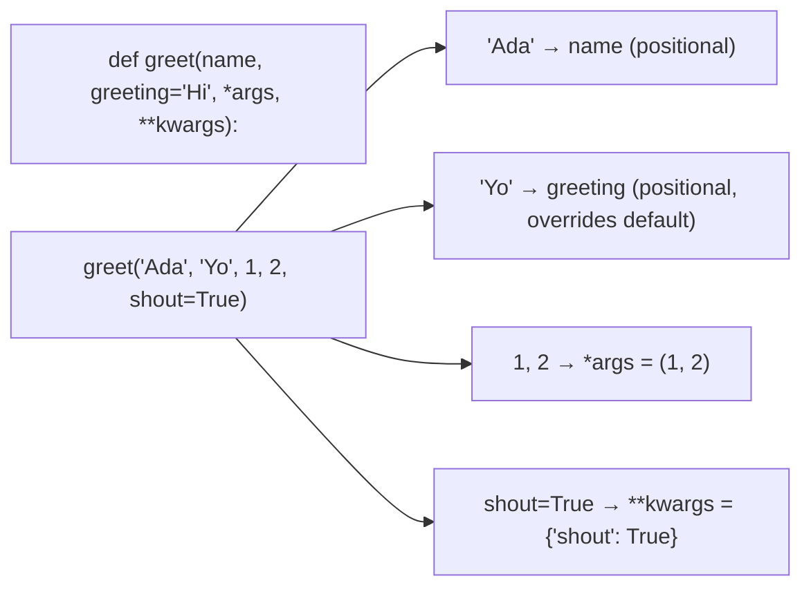
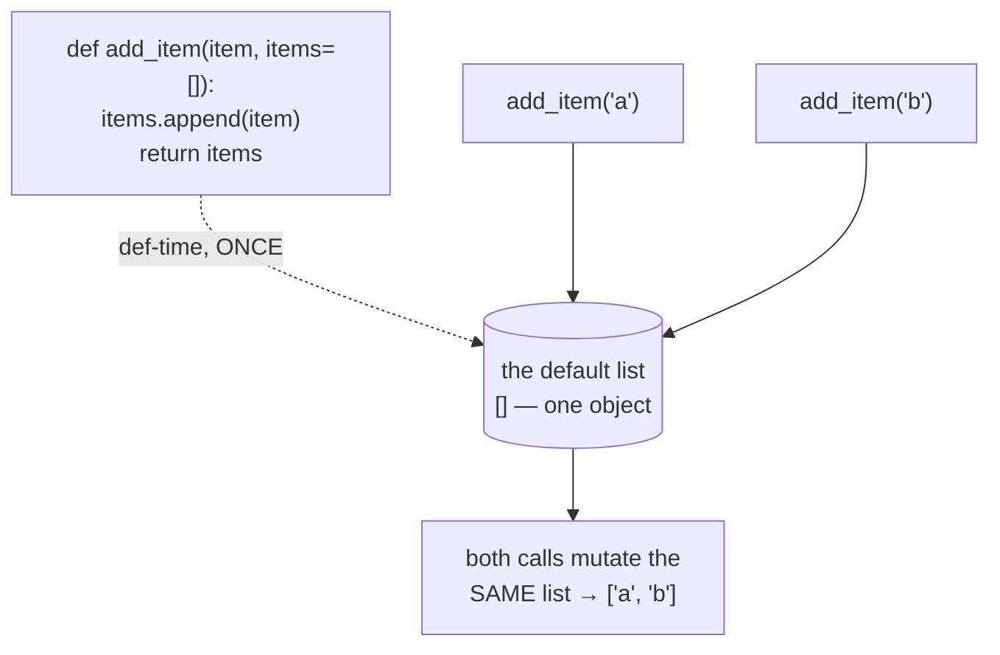
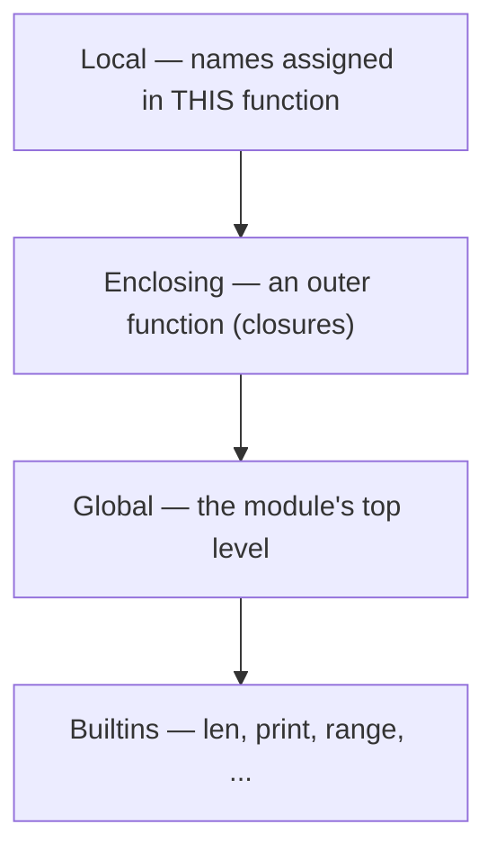
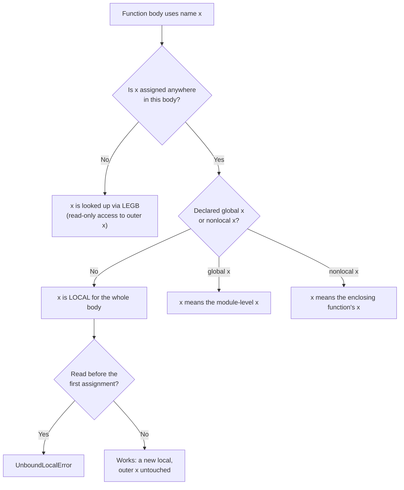
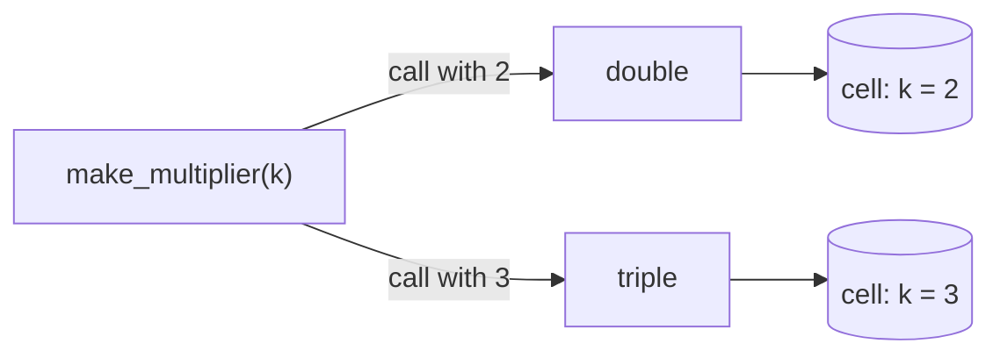
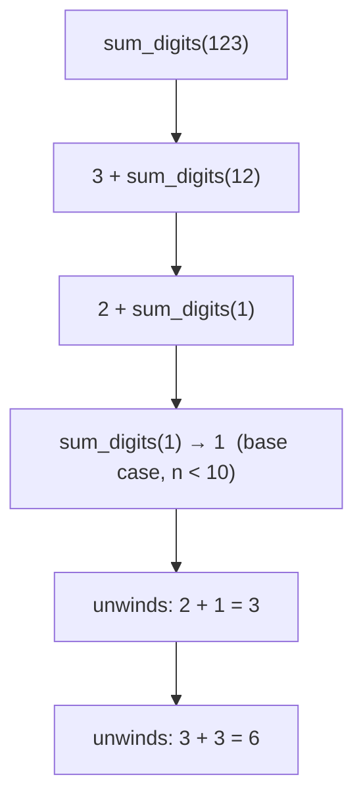

# 05 — Functions

## Why this exists

Copy-pasted code rots — fix a bug in one spot and forget the other three.
A function names a computation once, so you can reuse it, test it in
isolation, and give it a good name that explains *what* instead of
*how*. In Python, functions are also values: you can store one in a
variable, pass one to another function, or return one — that's what
makes decorators, `sorted(key=...)`, and callbacks possible later.

## Anatomy of a call



*What to notice: arguments are matched in a strict order — positional
args fill named parameters left-to-right first, then any leftover
positional args pile into `*args`, and any keyword args that don't match
a named parameter pile into `**kwargs`. A parameter with a default only
falls back to it when nothing else fills the slot.*

```python
def greet(name, greeting="Hi", *args, **kwargs):
    print(greeting, name)

greet("Ada")                     # Hi Ada
greet("Ada", "Yo")                # Yo Ada
```

A function that never hits `return` — or hits a bare `return` — sends
back `None`. Forgetting the `return` line is a common bug: the function
*runs* fine, it just silently gives you nothing useful back.

## Defaults + the mutable-default trap

Default values are objects created **once**, when Python reads the
`def` line — not fresh on every call. That's harmless for immutable
defaults (`exp=2`) and dangerous for mutable ones (`items=[]`).



*What to notice: `items=[]` doesn't mean "a new empty list every call" —
it means "this one list, forever," because it was built once at
def-time. Every call that omits `items` shares and mutates it.*

The fix is the **None-sentinel**: default to `None`, then build the real
mutable value fresh, inside the function body, every call.

```python
def add_item(item, items=None):
    if items is None:
        items = []          # a brand-new list, every call
    items.append(item)
    return items
```

## `*args` / `**kwargs`: collecting and forwarding

`*args` collects extra positional arguments into a tuple; `**kwargs`
collects extra keyword arguments into a dict. The same stars *unpack* a
tuple/dict back into separate arguments when calling — that's how you
forward a call unchanged.

```python
def total(*nums):
    return sum(nums)

total(1, 2, 3)          # 6

def forward(func, *args, **kwargs):
    return func(*args, **kwargs)   # unpack and pass straight through

forward(total, 1, 2, 3)  # 6
```

## Keyword-only and positional-only parameters

A bare `*` in the parameter list means "everything after this must be
passed by keyword." A bare `/` means "everything before this must be
passed positionally." APIs use these to force a clear, unambiguous call
site.

```python
def make_user(name, *, admin=False):   # admin MUST be a keyword
    ...

make_user("Ada", admin=True)   # OK
make_user("Ada", True)          # TypeError

def divide(a, b, /):            # a, b MUST be positional
    return a / b

divide(6, 3)          # OK
divide(a=6, b=3)      # TypeError
```

## Scope & LEGB

Every name lookup follows the same four rings, checked in order —
Python stops at the first ring where the name exists.



*What to notice: Python searches Local → Enclosing → Global → Builtins
and stops at the first match. A local variable with the same name as a
global one always wins inside its own function — that's shadowing, not
an error.*

```python
color = "global red"

def outer():
    color = "enclosing green"
    def inner():
        return color      # not Local → found in Enclosing
    return inner()

outer()   # 'enclosing green'
color     # 'global red' — outer's `color` was a separate name
```

### Read vs assign: the one rule behind it all

Reading an outer name just works. No keyword is needed.

**Assigning** is different. Python decides which names are local
*before the function runs*. It scans the whole body, and any name
assigned anywhere in it (`=`, `+=`, `for x in`, `def x`) becomes local
for the **whole** function, including the lines above the assignment.



*What to notice: Python makes this choice at compile time, for the
whole body. That's why reading a name on line 1 can fail because of an
assignment on line 2.*

```python
score = 10

def read_only():
    return score + 1          # 11: read → finds the global

def new_local():
    score = 99                # a NEW local; the global stays 10
    return score

def broken():
    score = score + 1         # UnboundLocalError!
    return score              # `score` is local here, and empty on the right side
```

| What the function does with `x` | Keyword needed? | Result |
| --- | --- | --- |
| Only reads `x` | no | finds the outer `x` via LEGB |
| Assigns `x`, never reads it first | no | a new local `x`; the outer one is untouched |
| Reads, then assigns `x` | **yes** | without a keyword → `UnboundLocalError` |
| Mutates `x` (`x.append(...)`, `x["k"] = v`) | no | changes the outer object, because `x` itself isn't rebound |

### `global`: rebind a module-level name

`global x` says "when I assign `x` in this function, I mean the
module's `x`."

```python
debug = False

def enable_debug():
    global debug
    debug = True

enable_debug()
debug    # True
```

Use it sparingly. Any function anywhere can change a global, so bugs
are hard to trace. It also makes tests depend on the order they run in.
Usually a return value, a parameter, or a closure is the better choice.

### `nonlocal`: rebind an enclosing function's name

`nonlocal x` says "when I assign `x`, I mean the nearest enclosing
**function's** `x`." It never reaches the global scope.

```python
def make_limiter(max_calls):
    remaining = max_calls
    def allow():
        nonlocal remaining          # without this: UnboundLocalError
        if remaining == 0:
            return False
        remaining -= 1
        return True
    return allow

allow = make_limiter(2)
[allow() for _ in range(4)]   # [True, True, False, False]
```

| | `global x` | `nonlocal x` |
| --- | --- | --- |
| Rebinds | the module's `x` | the nearest enclosing function's `x` |
| Where it's used | any function | only a nested function |
| `x` must already exist? | no (it creates the global) | **yes**, otherwise `SyntaxError` |
| Typical use | rare: module flags, caches | closures that keep state between calls |

### Mutating isn't assigning

`.append()` changes the object. It doesn't rebind the name, so you
don't need a keyword.

```python
def make_logger():
    history = []
    def log(msg):
        history.append(msg)   # same list, no rebinding → no nonlocal
    return log, history
```

Coming from TypeScript: JS closures can reassign outer `let` variables
with no keyword. Python makes you say `nonlocal`, because to Python a
bare `x = ...` always means "make a new local".

→ Demo: `playground/05-functions/legb_global_nonlocal.py`

## Closures: functions that remember

A closure is a function that captures variables from its enclosing
scope and keeps them alive after that scope returns. The classic use is
a **factory**: a function that builds and returns a customized function.

```python
def make_multiplier(k):
    def multiply(n):
        return n * k        # `k` is remembered, not re-read from globals
    return multiply

double = make_multiplier(2)
triple = make_multiplier(3)
double(5)   # 10
triple(5)   # 15 — independent state, separate closures
```

Each call to the factory creates a fresh variable. The returned
function holds on to it in a **cell**.



*What to notice: one factory, two calls, two separate cells. `double`
and `triple` never share state.*

You can see the cells directly:

```python
double.__code__.co_freevars          # ('k',)
double.__closure__[0].cell_contents  # 2
```

### A closure captures the variable, not its value

The cell holds the *variable*. The inner function reads it **when it
runs**, not when it was defined. So if the variable changes later, the
closure sees the new value:

```python
def make_reader():
    mood = "calm"
    def read():
        return mood
    def set_mood(new):
        nonlocal mood
        mood = new
    return read, set_mood

read, set_mood = make_reader()
read()              # 'calm'
set_mood("excited")
read()              # 'excited': same cell, new value
```

This is called **late binding**. It's the cause of the loop-variable
gotcha below, which ex06 covers.

### Closure or class?

A closure with `nonlocal` state is a tiny object with one method.

| | Closure | Class |
| --- | --- | --- |
| State lives in | cells captured from the factory | `self.attributes` |
| Good for | one behavior + a little private state | several methods, or state others inspect |
| Callers see | a plain function | an object with attributes |

Coming from TypeScript, it's tempting to reach for a class. If there's
only one method, a closure is usually the more Pythonic choice.

→ Demo: `playground/05-functions/closure_cells.py`

## `lambda`: single expressions only

`lambda` builds a tiny, unnamed function that is **one expression** —
no statements, no `return` keyword, the expression's value comes back
automatically. It shines as a `key=` argument; once the logic grows past
one expression, write a named `def` instead — it's more readable and
you can give it a docstring.

```python
words = ["fig", "kiwi", "apple"]
sorted(words, key=lambda w: len(w))   # ['fig', 'kiwi', 'apple']

# same thing, named — prefer this once it's more than a one-liner
def word_length(w):
    return len(w)
sorted(words, key=word_length)
```

## Recursion: base case + smaller problem

A recursive function solves a problem by (1) handling the smallest case
directly — the **base case** — and (2) calling itself on a *smaller*
version of the problem, trusting that call to work.



*What to notice: the calls stack up (going down the diagram) until the
base case stops the recursion, then each call returns its answer back
up to the caller that's waiting on it — the stack unwinds in reverse
order.*

Every recursive function needs a base case that doesn't recurse, and
every recursive call must move strictly closer to it — otherwise it
recurses forever (until Python's stack gives up with
`RecursionError`).

## Gotchas

| Gotcha | What happens | Fix |
| --- | --- | --- |
| `def f(items=[]):` | one shared list, mutated across every call that omits it | default to `None`, build the real value inside the body |
| Closures capturing a loop variable | every closure sees the loop's *final* value, not the value at creation time | bind it as a default argument: `def h(i=i): ...`, or use a factory function |
| Reading a name, then assigning it, in the same function | `UnboundLocalError`: the assignment made it local for the whole body | `global x` / `nonlocal x`, or better, return the new value |
| `nonlocal x` with no enclosing function `x` | `SyntaxError: no binding for nonlocal 'x' found` | define `x` in the enclosing function first |
| Shadowing a builtin (`list = [1, 2]`, `def sum(...)`) | the builtin is unreachable by that name for the rest of the scope | pick a different name (`items`, `total`) |
| Forgetting `return` | the function runs, but silently gives back `None` | add the `return` — implicit `None` is easy to miss |

## Try it now

→ `exercises/ex01_define_return.py` through `exercises/ex08_recursion.py`,
then `checkpoint_05.py`.
Check with `uv run pytest 05-functions`.
