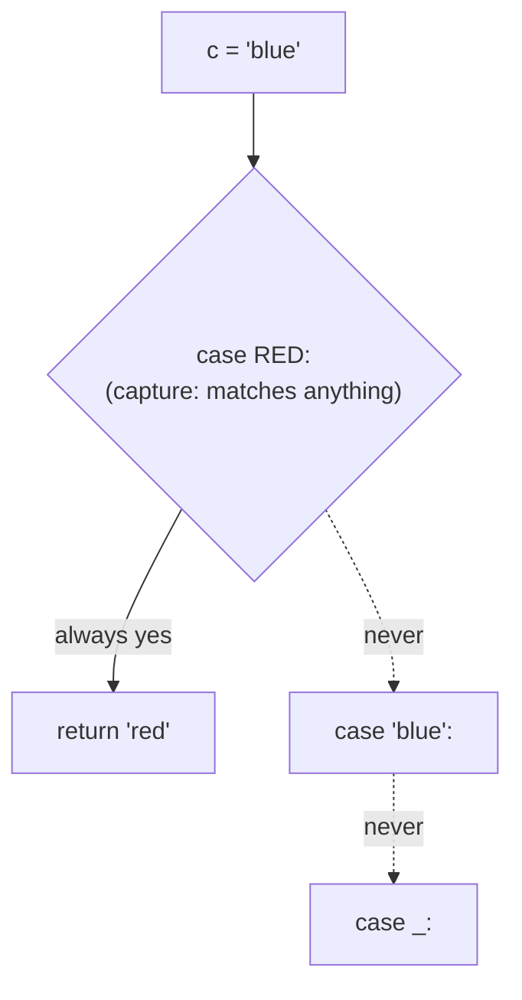
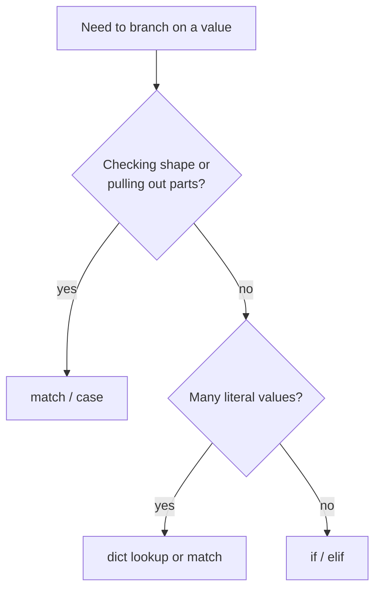

# `match` / `case` — not a `switch`

`match` looks like a TS `switch`. For plain literals it acts like one.
But it is **structural pattern matching**: it checks the *shape* of a
value and can pull pieces out of it.

Demos: [match_vs_switch.py](match_vs_switch.py),
[match_capture_order.py](match_capture_order.py).

## `switch` vs `match`

| | TS `switch` | Python `match` |
|---|---|---|
| Compares with | `===` against each `case` | **patterns**: literals, shapes, types |
| Fall-through | Yes, unless you `break` | Never. First matching case wins |
| Several values | Stack `case 1: case 2:` | `case 1 \| 2:` |
| Default | `default:` | `case _:` |
| Destructuring | No | Yes: `case (x, 0):`, `case {"x": x}:` |
| Conditions | No | Guards: `case (x, y) if x == y:` |
| Bare name `case foo:` | Compares to the variable `foo` | **Assigns** the value to `foo`. Matches everything |

## Literals: looks like a switch

```python
def http_status(code: int) -> str:
    match code:
        case 200:
            return "OK"
        case 404:
            return "Not Found"
        case 500 | 502 | 503:   # "or" pattern, no fall-through needed
            return "Server error"
        case _:                 # wildcard = default
            return "Unknown"
```

## Shapes: what a switch can't do

```python
def describe(point: object) -> str:
    match point:
        case (0, 0):
            return "origin"
        case (x, 0):                    # destructure + bind x
            return f"on the x-axis at {x}"
        case (x, y) if x == y:          # guard
            return f"on the diagonal at {x}"
        case {"x": x, "y": y}:          # dict pattern
            return f"dict point ({x}, {y})"
        case _:
            return "something else"
```

A tuple pattern also checks **length**. `describe((5, 0, 0))` has three
items, so no tuple case matches. It returns `"something else"`.

## The gotcha: a bare name is a capture

A bare name in a pattern is a **capture slot**, like `x` in `case (x, 0)`.
It does not compare against a variable.

```python
RED = "red"

match c:
    case RED:       # means "match anything, call it RED"
        ...         # NOT "compare to the constant RED"
```

`case RED:` matches every value. It also **overwrites** `RED` with `c`.

## Where the capture sits matters

`match` checks cases top to bottom and stops at the first match. A
capture matches everything, so any case after it is dead code.


*Caption: a capture at the top swallows every value, so the cases below can never be reached.*

Python treats that dead code as a bug. It raises a `SyntaxError` at
**compile time**, so not a single line of the file runs:

```text
SyntaxError: name capture 'RED' makes remaining patterns unreachable
```

If the capture is the **last** case, there is no dead code. Python
accepts it silently as a catch-all, so the bug slips through.

| Where the capture is | What Python does |
|---|---|
| Before other cases | `SyntaxError`: file won't run |
| Last case | Accepted silently. Acts as a catch-all (maybe not what you meant) |

The same rule applies to `case _:`. Anywhere but last gives
`SyntaxError: wildcard makes remaining patterns unreachable`.

## The fix: literals or dotted names

Python compares (instead of capturing) when the pattern is a **literal**
or a **dotted name**:

```python
from enum import Enum

class Color(Enum):
    RED = "red"
    BLUE = "blue"

match Color(c):
    case Color.RED:     # dotted name -> compares
        ...
    case Color.BLUE:
        ...
    case _:
        ...

match c:
    case "red":         # literal -> compares
        ...
```

## When to use which


*Caption: choosing between `if/elif`, a dict, and `match`.*

- **A few plain value checks**: `if/elif` is usually clearer.
- **Branching on the shape of data** (tuples, dicts, command tokens,
  JSON): `match` is much better than a switch.

## Remember

- `match` = pattern matching, not `switch`. No fall-through, no `break`.
- `case name:` **captures**. To compare, use a literal or `Some.DOTTED`.
- `case _:` and captures go **last**, or Python won't compile the file.
