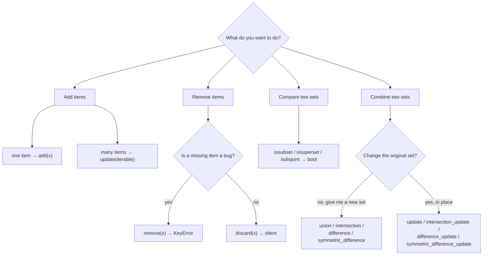

# Set methods: which one do I want?

_Caption: pick a set method by the question you are asking. Combining
methods come in pairs: one returns a new set, its `_update` twin changes
the set in place and returns `None`._

Runnable demo: `uv run python playground/04-collections/set_methods.py`
