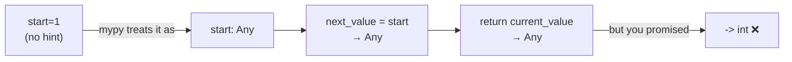

# How an unhinted parameter becomes `Any`

From ex05_scope: `def make_id_generator(start=1) -> Callable[[], int]`.

*An unhinted parameter becomes `Any`, and that `Any` passes into every variable built from it.*

mypy reads hints. It doesn't guess a parameter's type from its default value.

Fix: `start: int = 1`. With a hint, put spaces around `=`. Without one, write `start=1`.

See also `callable_hints.py`: write function types as `Callable[[args], return]`, imported from `collections.abc`. Lowercase `callable` is the built-in check `callable(x) -> bool`. It can't be used as a type.
