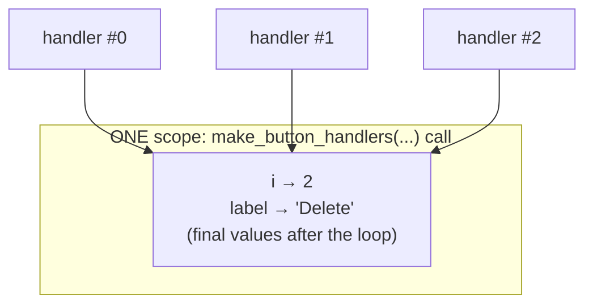
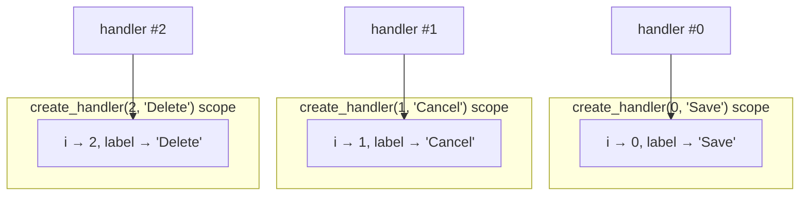
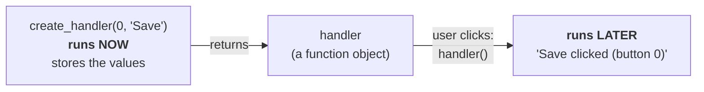

# Why closure factories exist

This lesson covers the bug we hit in `ex06_closures.make_button_handlers`
and how a factory function fixes it.

Demo: `uv run python playground/05-functions/closure_factory.py`

## 1. The goal

We want a list of buttons. Each button has a click handler: a
zero-argument function that reports *which* button was clicked.

```python
handlers = make_button_handlers(["Save", "Cancel", "Delete"])
handlers[0]()  # "Save clicked (button 0)"
handlers[2]()  # "Delete clicked (button 2)"
```

The handlers are made **now**, in a loop. They are called **later**,
when a user clicks. That gap in time is where the problem comes from.

## 2. The problem: closures capture variables, not values

The natural first attempt:

```python
for i, label in enumerate(labels):
    def handler() -> str:
        return f"{label} clicked (button {i})"
    handlers.append(handler)
```

Every handler says `"Delete clicked (button 2)"`.

A closure does not copy `i` and `label` when it is defined. It keeps a
**reference to the variable itself**. All the handlers are created in
the same function call, so they all point at the **same** `i` and
`label`. The loop keeps changing those two variables. By the time anyone
clicks, the loop has finished and they hold the last values.



*What to notice: three handlers, one shared variable. Whatever is in it
at click time is what all three report.*

Think of it as three sticky notes all saying "look in box `i`". They don't
say "the number 0". (The demo proves the sharing: `hs[0].__closure__[0] is
hs[2].__closure__[0]` is `True`.)

> **Coming from TypeScript:** this is the old `var` bug in a `for` loop
> with `setTimeout`. JS fixed it with `let`, which gives every loop pass
> a fresh binding. Python has no `let`. A `for` loop never creates a new
> scope, so you have to make one yourself.

### "But `def` runs on every pass, so isn't each handler new?"

Yes, but only the *function* is new. The *variables* are not:

| Each loop pass creates… | Plain loop + `def` |
|---|---|
| a new function object | ✅ `hs[0] is not hs[2]` |
| new `i` / `label` variables | ❌ all handlers share `make_button_handlers`'s single `i` and `label` |

In Python, **only a function call creates a new scope**. A `for` loop
doesn't. To give each handler private variables, something has to call a
function once per pass. That is the factory's job.

## 3. Fix A: default arguments (quick but leaky)

```python
def handler(i: int = i, label: str = label) -> str: ...
```

Default values are worked out **once, when `def` runs**. Each handler
therefore stores its own copy of the current `i` and `label`. This works.

The cost: `i` and `label` are now **parameters**, part of the public
signature.

```python
handlers[0](99, "Oops")  # "Oops clicked (button 99)", silently wrong
```

mypy notices as well. The handler's real type is `(int, str) -> str`, so
it does not match the promised `Callable[[], str]`.

## 4. Fix B: a factory makes a fresh scope per handler

A factory is a function whose job is to **build and return another
function**.

```python
def create_handler(i: int, label: str) -> Callable[[], str]:
    def handler() -> str:
        return f"{label} clicked (button {i})"
    return handler                     # the function, not handler()

def make_button_handlers(labels: list[str]) -> list[Callable[[], str]]:
    return [create_handler(i, label) for i, label in enumerate(labels)]
```

Every **function call** creates a brand-new local scope. Calling
`create_handler` three times creates three separate scopes, each with its
own `i` and `label`. Each handler closes over its own scope, so nothing
is shared.



*What to notice: the factory call is what creates a new scope. One call
per button means one private set of variables per handler.*

Now the signature is honest. `handler()` takes nothing, so
`handlers[0](99, "Oops")` raises `TypeError`, and mypy accepts
`Callable[[], str]`.

## 5. The two layers, and the mistake to avoid

A factory always has **two layers** that run at different times:



*What to notice: the outer function returns a function. The string only
gets built when that returned function is called.*

If you drop the inner layer, you no longer have a factory:

```python
def create_handler(i: int, label: str) -> str:
    return f"{label} clicked (button {i})"   # builds the string NOW
```

That returns `"Save clicked (button 0)"`, a `str`. Calling it later
(`handlers[0]()`) raises `TypeError: 'str' object is not callable`.
mypy flags it first: `got "list[str]", expected "list[Callable[[], str]]"`.

## 6. Which fix to use

| | Loop + plain closure | Default-arg trick | Factory function |
|---|---|---|---|
| Each handler has its own values | ❌ all share the last | ✅ | ✅ |
| Handler signature | `() -> str` | `(i=…, label=…) -> str` | `() -> str` |
| `handlers[0](99, "Oops")` | `TypeError` | runs, wrong output | `TypeError` |
| Matches `Callable[[], str]` in mypy | ✅ (but buggy) | ❌ | ✅ |
| Best for | never | quick scripts, one-liners | anything other code will call |

You already wrote factories before this one: `make_multiplier` and
`make_accumulator` are both factories. `make_button_handlers` just calls
a factory once per loop pass.

## Self-check

1. Why does the plain loop version report the last button for every handler?
2. Which part of the factory version creates a new scope: the `for`
   loop, or the call to `create_handler`?
3. What goes wrong if the factory ends with `return handler()` instead
   of `return handler`?
