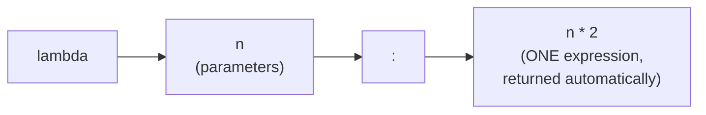
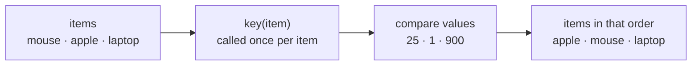
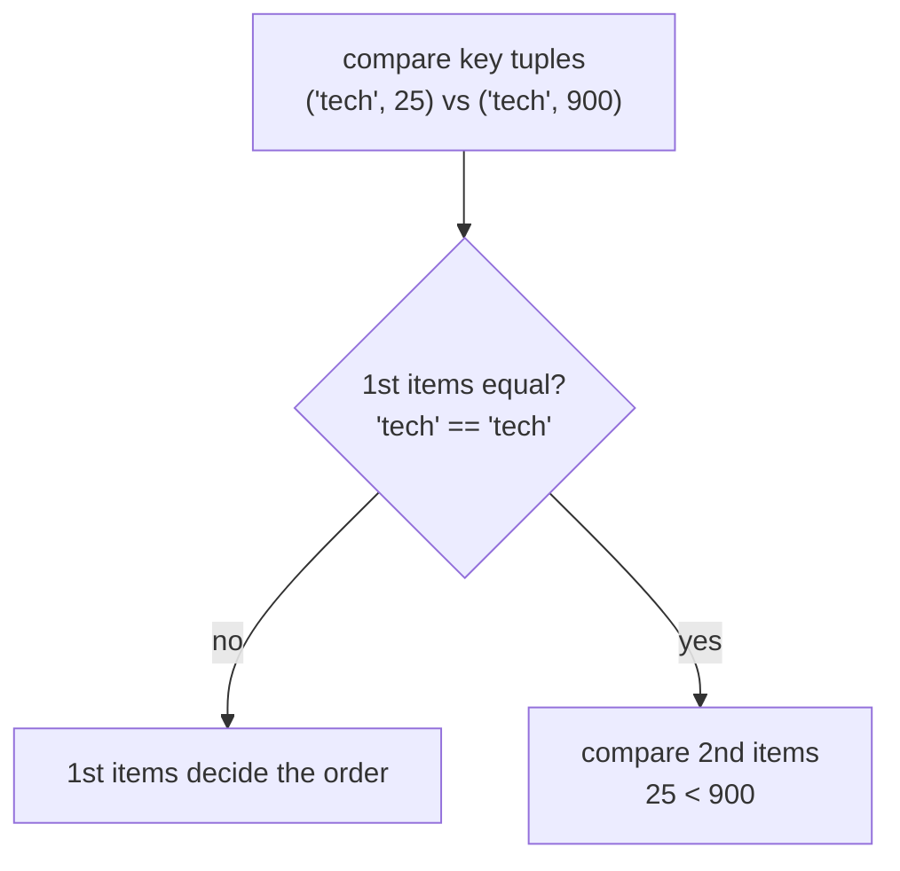
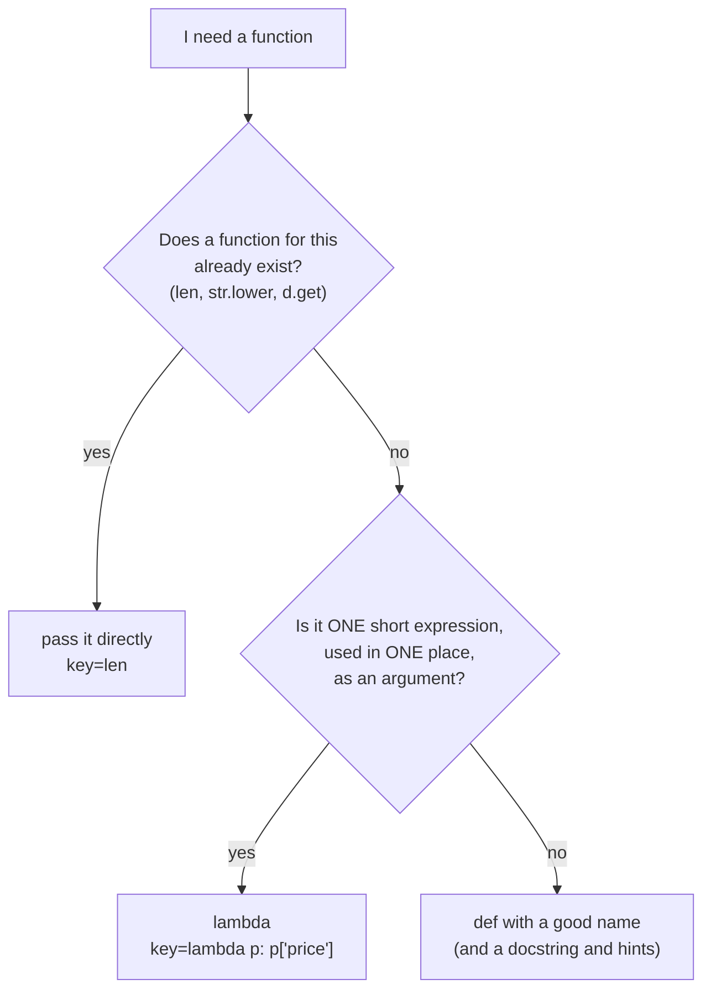

# `lambda`: small functions you pass to other functions

A dedicated lesson on `lambda`: what it is, where it fits, and when a
plain `def` (or no function at all) is the better choice. It expands
the short section in `05-functions/LESSON.md`, and it's the background
for `ex07_sorting_keys`.

Demo: `uv run python playground/05-functions/lambda_functions.py`

## 1. A lambda is a `def` without a name

`lambda` makes a function object, the same kind of thing `def` makes.
It just skips the name, the `return`, and the block.

```python
def double(n):
    return n * 2

lambda n: n * 2        # the same function, unnamed
```



*What to notice: there is no `return` keyword. Whatever the expression
evaluates to is the return value.*

Both are type `function`. You call them the same way. The only visible
difference is the name: `double.__name__` is `'double'`, and the
lambda's is `'<lambda>'`.

> **Coming from TypeScript:** `lambda n: n * 2` is `(n) => n * 2`.
> Python has no block-body form like `(n) => { ... }`. If you need a
> block, you need a `def`.

## 2. The rule: one expression, no statements

The body must be a single **expression**: something that produces a
value. **Statements** (things that *do* something) aren't allowed.

| Allowed in a lambda ✅ | Not allowed ❌ (SyntaxError) |
|---|---|
| arithmetic, comparisons: `n * 2`, `n > 0` | `return n` |
| function and method calls: `len(s)`, `s.lower()` | assignment: `total = n` |
| indexing: `p["price"]`, `pair[0]` | `if` / `for` / `while` blocks |
| conditional expression: `"even" if n % 2 == 0 else "odd"` | several lines, `try` / `except` |
| tuples, f-strings, comprehensions | type hints on parameters, a docstring |

Parameters work just like `def`: `lambda: 42` (none),
`lambda a, b: a + b`, `lambda x, step=1: x + step`.

## 3. Where lambdas belong: as an argument

A lambda is meant to be **passed**, not stored. The main use is the
`key=` parameter of `sorted`, `min`, `max`, and `list.sort`.

`key` answers one question: **"what should I compare for this item?"**
Python calls the key function once per item, then compares the
results, not the items.



*What to notice: the key's values decide the order, but you get the
original items back, not the key values.*

```python
products = [
    {"name": "mouse", "price": 25},
    {"name": "apple", "price": 1},
    {"name": "laptop", "price": 900},
]

sorted(products, key=lambda p: p["price"])               # apple, mouse, laptop
min(products, key=lambda p: p["price"])                  # {'name': 'apple', ...}
max(products, key=lambda p: len(p["name"]))              # {'name': 'laptop', ...}
sorted(products, key=lambda p: p["price"], reverse=True) # laptop, mouse, apple
```

Section 2 of the demo prints every key call, so you can watch it work.

> **Coming from TypeScript:** JS `sort` takes a comparator,
> `(a, b) => a.price - b.price`, that looks at two items. Python's `key`
> takes **one** item and returns what to compare. It's simpler, and
> Python calls it once per item instead of once per comparison.

## 4. Tuple keys: sort by this, then by that

Tuples compare item by item: first elements first, and only on a tie
does the next element matter.

```python
sorted([(2, "b"), (1, "z"), (2, "a")])   # [(1, 'z'), (2, 'a'), (2, 'b')]
```

So to sort by several fields, return a tuple from the key:

```python
# by category, then by price within each category
sorted(products, key=lambda p: (p["category"], p["price"]))
```



*What to notice: the second element is a tie-breaker. It only matters
when everything before it is equal.*

Mixed directions (one field ascending, one descending)? For numbers,
negate that field: `key=lambda p: (p["category"], -p["price"])` gives
categories A→Z and prices high→low inside each one.

## 5. Don't wrap a function that already exists

If the lambda only calls one function with the same argument, pass
that function directly:

| Wrapped (works, but noisy) | Direct (Pythonic) |
|---|---|
| `key=lambda w: len(w)` | `key=len` |
| `key=lambda s: s.lower()` | `key=str.lower` |
| `key=lambda k: stock.get(k)` | `key=stock.get` |
| `map(lambda s: s.strip(), lines)` | `map(str.strip, lines)` |

Pass the function, **don't call it**: `key=len`, not `key=len()`. `len`
is the function, and `len()` would try to run it right now with no
arguments.

`max(stock, key=stock.get)` is a handy idiom: "the dict key with the
biggest value".

## 6. `map` / `filter` + lambda vs a comprehension

`map` and `filter` take a function, so they often get a lambda. In
Python a comprehension is usually clearer:

| Goal | `map` / `filter` + lambda | Comprehension (preferred) |
|---|---|---|
| transform | `list(map(lambda x: x * 2, xs))` | `[x * 2 for x in xs]` |
| keep some | `list(filter(lambda x: x > 10, xs))` | `[x for x in xs if x > 10]` |
| both | `list(map(lambda x: x * 2, filter(lambda x: x > 10, xs)))` | `[x * 2 for x in xs if x > 10]` |

This repo's ruff config agrees: `map(lambda ...)` triggers **C417
"Unnecessary map() usage"**. `map` is still fine with a function that
already has a name: `map(str.strip, lines)`.

## 7. Lambda or `def`?



*What to notice: a lambda is the middle option. Use it only when there
is no ready-made function and the logic still fits on one short line.*

| | `lambda` | `def` |
|---|---|---|
| Body | one expression | any statements |
| Name in tracebacks | `<lambda>` | the real name |
| Docstring / type hints | ❌ | ✅ |
| Reusable / testable on its own | not really | ✅ |
| Best for | throwaway `key=` / callback arguments | everything else |

**Don't assign a lambda to a name.** `double = lambda n: n * 2` works,
but PEP 8 says to write `def double(n): return n * 2` instead (that's
ruff rule E731, which isn't switched on in this repo). Naming a lambda
gives you all the downsides of `def` and none of the upsides: the
traceback still says `<lambda>`, and you can't add a docstring.

(Preview, module 09: `operator.itemgetter("price")` is a ready-made
replacement for `lambda p: p["price"]`.)

## 8. Gotchas

| Gotcha | What happens | Fix |
|---|---|---|
| `[lambda x: x + i for i in range(3)]` | every lambda uses the **last** `i` (late binding, the same bug as `closure_factory.md`). Ruff flags it as **B023**. | bind it now: `lambda x, i=i: x + i`, or use a factory |
| `key=lambda p: p.get("price")` | a missing key returns `None`, then `sorted` crashes with `'<' not supported between 'NoneType' and 'int'`, far from the real cause | use `p["price"]`: a `KeyError` names the missing key. Use `.get` only when the spec gives a default |
| `key=len()` | `TypeError` now: `len` is called with no arguments | `key=len` (pass the function) |
| `items.sort(key=...)` used as a value | `.sort()` sorts in place and returns `None` | `sorted(items, key=...)` when you want a new list |
| a lambda that grows `if ... else ... if ... else` | it fits in one expression but nobody can read it | switch to a `def` |
| `lambda x: return x` | `SyntaxError` | drop `return`, since the expression is the return value |

## Self-check

1. Rewrite `def area(w, h): return w * h` as a lambda. Then explain why
   you'd keep the `def` version if `area` is used in three places.
2. What does `sorted(["b", "A", "c"], key=str.lower)` return? Why is
   `key=str.lower()` wrong?
3. You want people sorted by age (oldest first), and by name A→Z when
   ages tie. Write the key.
4. Predict: `fs = [lambda: n for n in "ab"]; [f() for f in fs]`.
5. Why is `key=lambda r: r["age"]` safer than `key=lambda r: r.get("age")`?
