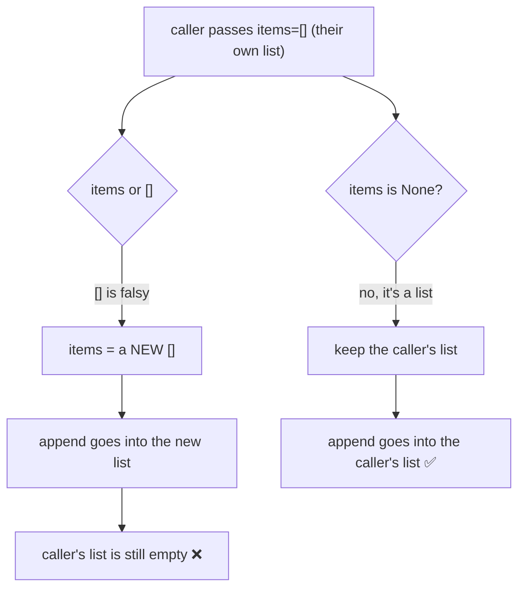

# `items or []` vs `if items is None`

Both look like a None-sentinel. They are not the same.

`or` checks for anything **falsy**: `None`, `[]`, `0`, `""`.
`is None` checks for `None` only.

So when the caller passes in an **empty list**, the two behave differently.

Demo: [or_vs_is_none.py](or_vs_is_none.py).

## The flow



*Caption: `or` replaces any falsy value, while `is None` replaces only `None`.*

## Output

```
or []    -> []      # caller's list was never touched
is None  -> [1]     # caller's list got the item
```

## Side by side

| | `items or []` | `if items is None: items = []` |
|---|---|---|
| Replaces | any falsy value (`None`, `[]`, `0`, `""`) | only `None` |
| Caller passes `[]` | gets a new list, the caller's list is ignored ❌ | uses the caller's list ✅ |
| Use it when | every falsy value should mean "use the default" | `None` is a sentinel meaning "not given" |

## Coming from TypeScript

`or` works like `||`, and `is None` works like `??`.
In JS, `[] || x` doesn't fall back because arrays are truthy.
In Python an empty list is falsy, so `or` is the riskier choice.

## Rule of thumb

- Sentinels: use `is None`.
- Use `or` only when "empty" and "missing" mean the same thing:
  `name = name or "Anonymous"`.
