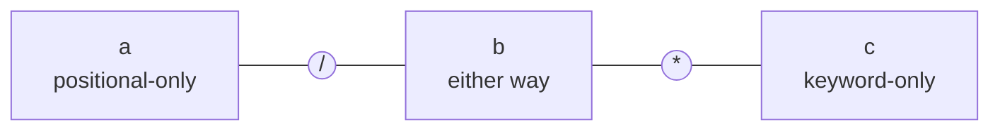

# The three parameter zones

*What to notice: `/` and `*` are fences. Left of `/` must be positional,
right of `*` must be keyword, and anything **between** them can be
passed either way. That middle zone is just a normal parameter.*

| Call | Result | Why |
|---|---|---|
| `f(1, 2, c=3)` | ✅ `(1, 2, 3)` | `b` passed positionally |
| `f(1, b=2, c=3)` | ✅ `(1, 2, 3)` | `b` passed by keyword, also fine |
| `f(a=1, b=2, c=3)` | ❌ TypeError | `a` is positional-only |
| `f(1, 2, 3)` | ❌ TypeError | `c` is keyword-only |

Demo: `uv run python playground/05-functions/param_zones.py`
