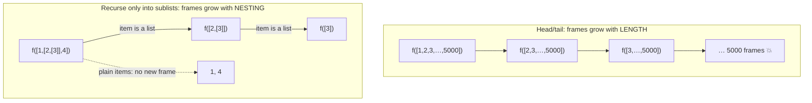

# Recursion depth: length vs nesting

Demo: `uv run python playground/05-functions/recursion_depth.py`

Python has no tail-call optimization. Every recursive call adds a stack
frame, and the default limit is about 1000 frames.

*Caption: A flat list of 5000 items is only 1 level deep. If each item
costs a frame, it still overflows. Spend a frame only when you go one
level deeper.*

| Strategy | Stack depth | Copies per call |
|---|---|---|
| `first, *rest` head/tail | length of list | whole tail (O(n²) total) |
| recurse only on nested lists | nesting depth | none |

**Rule of thumb:** use recursion for the *shape* of the data (depth) and
iteration for its *size* (breadth). (Coming from TypeScript: JS engines
mostly skip TCO too, so you'd hit the same wall there.)
