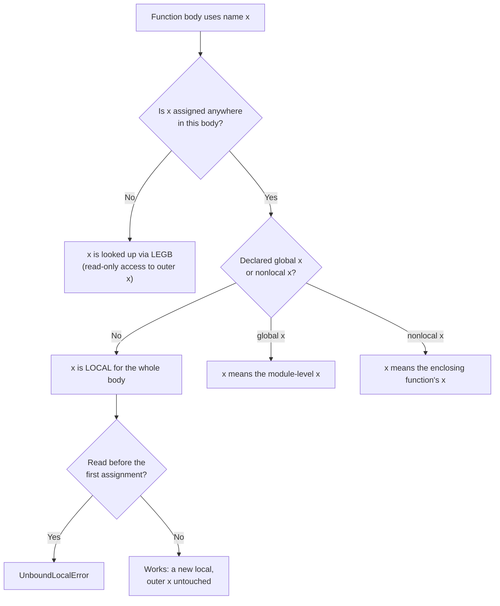
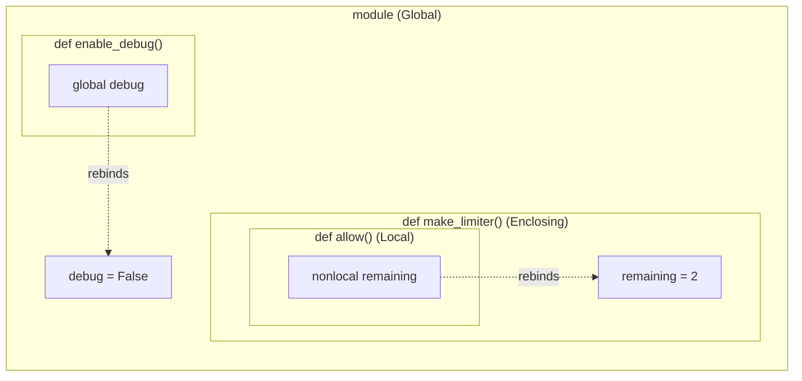
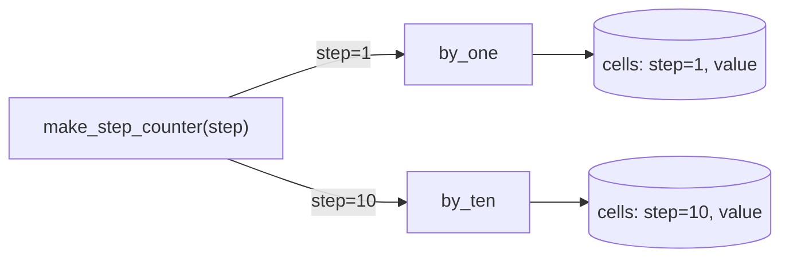

# Scope, `global`, `nonlocal`, closures — diagrams

Runnable companions: `legb_global_nonlocal.py` and `closure_cells.py`.

## 1. Is `x` local? Python decides before the function runs

*What to notice: a single assignment anywhere in the body makes the
name local everywhere in that body.*

## 2. Where each keyword points

*What to notice: `nonlocal` goes up one function and stops there.
`global` jumps straight to the module.*

## 3. Each factory call gets its own cell

*What to notice: calling `by_one()` never changes `by_ten`'s cells.*
