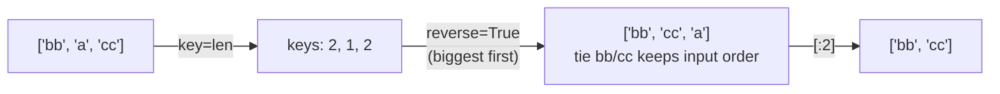

# Stable sort and ties

*Caption: `top_by(["bb", "a", "cc"], key_func=len, n=2)`, step by step. The key
picks the lengths, `reverse=True` puts the biggest first, and the slice keeps the top two.*

- `reverse=True` means **highest first**, so the shortest word (`"a"`) goes last.
- Python's sort is **stable**: items with equal keys keep their original order.
  This holds with `reverse=True` too. Python does not sort and then flip the list.
- `sorted(...)[::-1]` *does* flip the order of tied items, so it is not the same as `reverse=True`.

Run: `uv run python playground/05-functions/stable_sort_ties.py`
