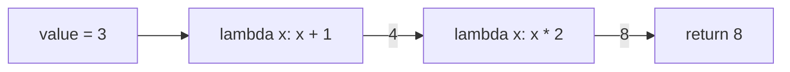
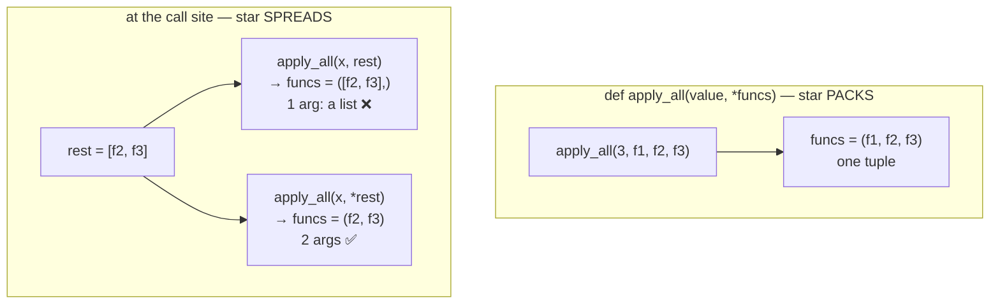
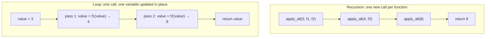
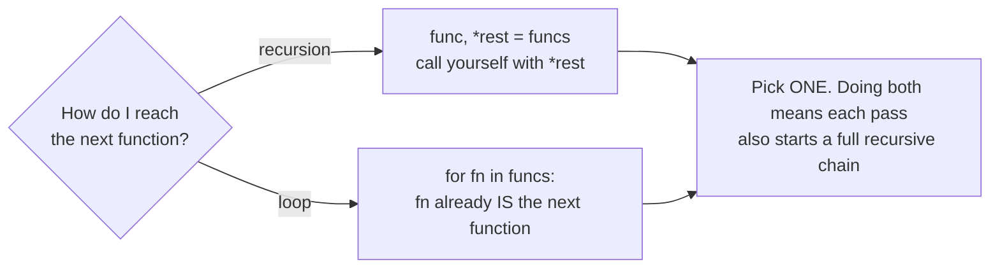

# Threading a value through `*funcs`

Run: `uv run python playground/05-functions/star_args_threading.py`

## What "thread through" means


*Each function's output is the next function's input. The last output is the answer.*

## Star when defining vs star when calling


*In a `def`, `*` collects separate arguments into one tuple. In a call, `*` unpacks a list or tuple back into separate arguments.*

## Annotating `*args`

The annotation on `*funcs` describes **one item**, not the whole tuple:

| TypeScript | Python |
|---|---|
| `...funcs: Fn[]` (annotates the array) | `*funcs: Callable[[Any], Any]` (annotates each item) |

`*funcs: list[Callable]` means "every argument is itself a list", which is wrong.

Check it with mypy: `uv run mypy playground/05-functions/star_args_hints.py`

```
def total(*nums: int)        -> nums is tuple[int, ...]
def wrong(*nums: list[int])  -> nums is tuple[list[int], ...]
```

`Callable` has two slots: `Callable[[arg types], return type]`. `...` in the
first slot means "any arguments". The return slot can never be left empty.

## Recursion vs loop: same values, different machinery


*Both produce 8. The recursive version stacks up one frame per function, so
around 1000 functions raise `RecursionError`. The loop reuses one name.*

## Don't mix the two


*A loop and recursion are two ways of doing the same walk. Using both at once
does the work over and over: 8 functions make 623,530 calls
(`hybrid_call_count.py`).*
