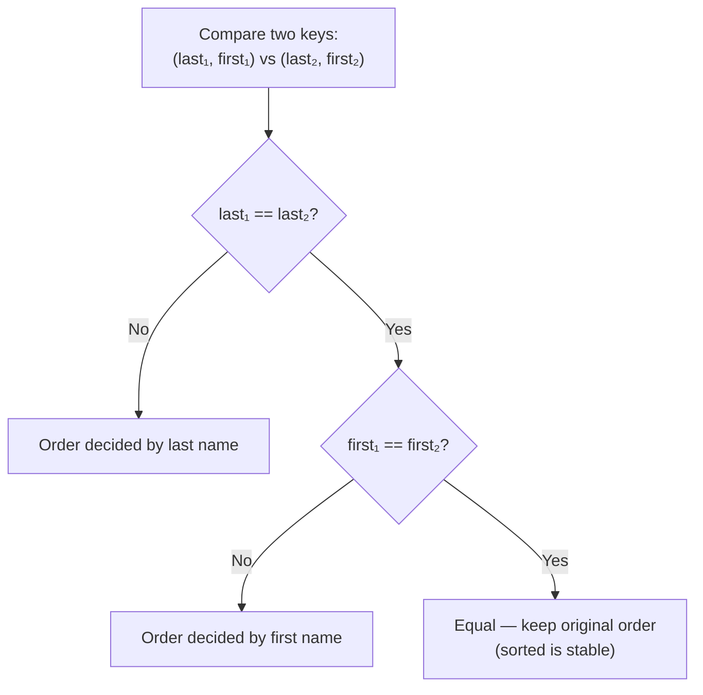
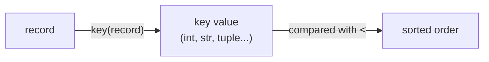

# Tuple sort keys — "sort by A, then by B"

A tuple key sorts by its first item. It only looks at the next item when
the first items tie. That's how a phone book works: last name first, then
first name for people with the same last name.

*Caption: Python compares tuples left to right; later items only break ties.*

Runnable demo: [tuple_sort_keys.py](tuple_sort_keys.py)

## Not special syntax — just `key=` + tuple `<`

*Caption: `sorted` only asks "is key A < key B?" — the key's type decides what `<` means. Tuples define `<` item by item.*
