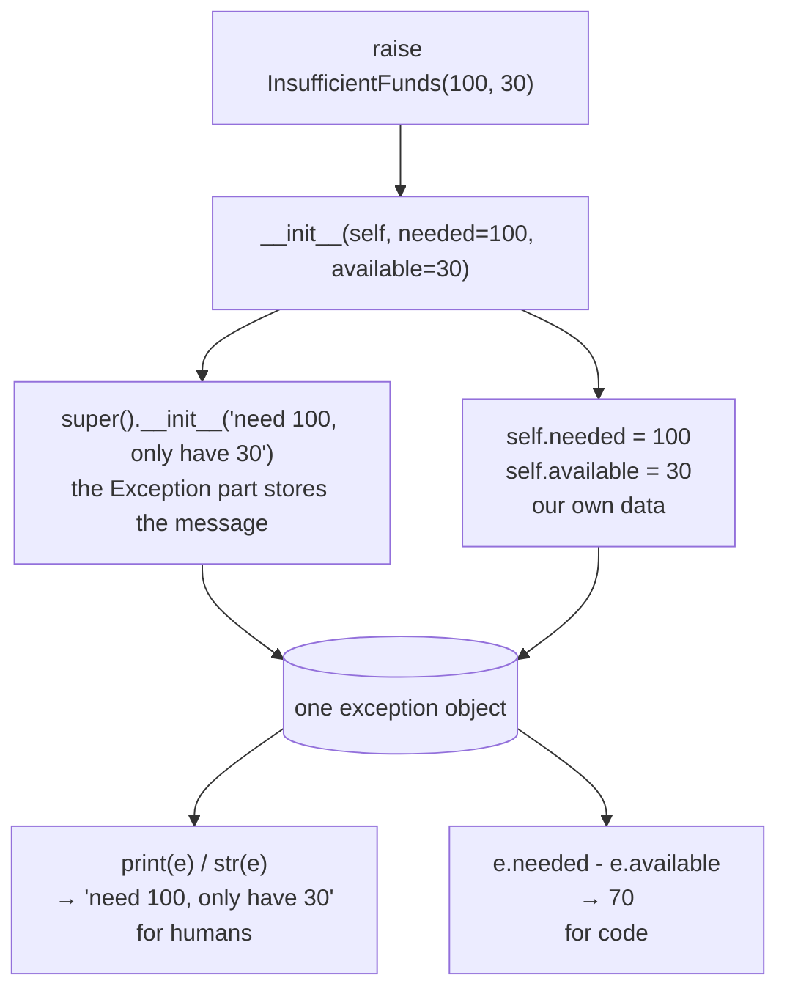

# Anatomy of a custom exception

Runnable demo: `uv run python playground/06-errors-files/custom_exception_anatomy.py`

```python
class InsufficientFunds(Exception):
    def __init__(self, needed, available):
        super().__init__(f"need {needed}, only have {available}")
        self.needed = needed
        self.available = available
```



*Caption: one object carries two things. The message (set by
`super().__init__`) is for humans. The attributes (set with `self.x = ...`)
are for code that wants to react.*

| Line | What it does | Who uses it |
|---|---|---|
| `class InsufficientFunds(Exception)` | "is a kind of" Exception, so `raise` and `except` accept it | Python |
| `def __init__(self, needed, available)` | runs when you create it: `InsufficientFunds(100, 30)` | Python |
| `super().__init__(msg)` | gives the message to the parent `Exception` | humans: logs, tracebacks, `print(e)` |
| `self.needed = needed` | stores raw data on the object | code: `e.needed` in an `except` block |

If you forget `super().__init__(msg)`, `str(e)` falls back to the raw
arguments: `'(100, 30)'`. It's not empty, but nobody can read it.
