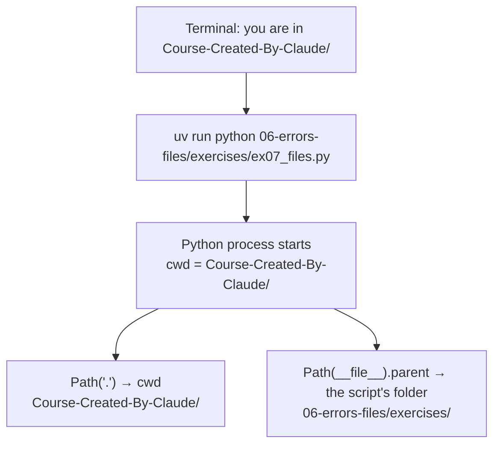

# `Path(".")` vs `Path(__file__).parent`

Demo: `uv run python playground/06-errors-files/dot_vs_file_dir.py`
(then run it again from a different folder and compare)

*Caption: `.` belongs to the running process (where you launched it), while
`__file__` belongs to the script file (where it sits on disk).*

| Expression | Means | Changes when you `cd` elsewhere? |
|---|---|---|
| `Path(".")` / `Path("./")` | current working directory | yes |
| `Path.cwd()` | same thing, written explicitly | yes |
| `Path(__file__).parent` | folder containing this `.py` file | no |
