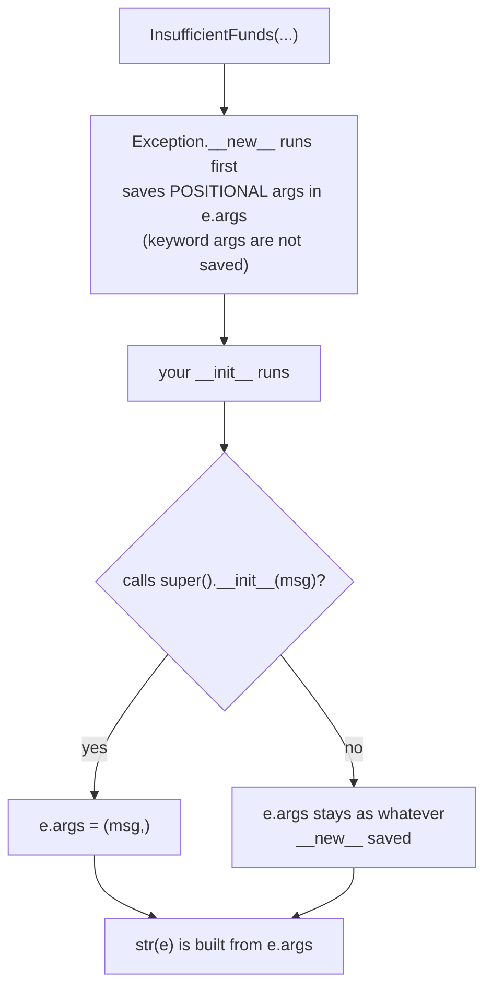

# Why custom exceptions call `super().__init__()`

Companion to [`exception_args.py`](exception_args.py). Run it with:

```bash
uv run python playground/06-errors-files/exception_args.py
```

## What happens when you raise



*Caption: `str(e)` always comes from `e.args`. `super().__init__(msg)` is how you control what goes in there.*

## How `e.args` becomes `str(e)`

| `e.args` | `str(e)` |
|---|---|
| `()` | `''` (empty) |
| one item | that item, as a string |
| two or more items | the whole tuple, like `'(150, 100)'` |

## Results from the demo

| Call | `e.args` | `str(e)` |
|---|---|---|
| `WithSuper(150, 100)` | `('need 150, only have 100',)` | `'need 150, only have 100'` |
| `NoSuper(150, 100)` | `(150, 100)` | `'(150, 100)'` |
| `NoSuper(needed=150, available=100)` | `()` | `''` |

The last row is the dangerous one. With keyword arguments and no
`super().__init__`, the traceback shows just `NoSuper` and no message.

## Coming from TypeScript

Same idea as `super(message)` in `class X extends Error`. TypeScript
**forces** you to call `super`. Python doesn't, so leaving it out fails
quietly.

## Rule of thumb

In a custom exception's `__init__`, always call
`super().__init__(...)` with a readable message, then set your extra
attributes.
