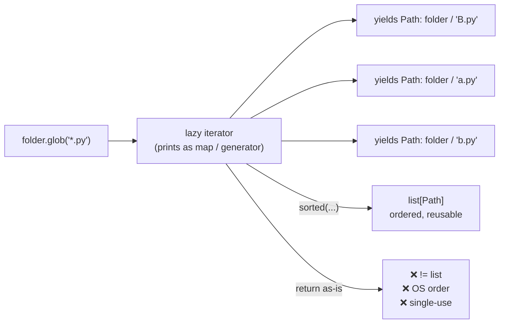

# `glob` gives an iterator — `sorted` gives a list

Runnable demo: `uv run python playground/06-errors-files/glob_iterator.py`

From ex06 `find_py_files`:

```python
return sorted(folder.glob("*.py"))
```

Question: is the `sorted` needed, or would `folder.glob("*.py")` alone work?



*Caption: `glob` already joins the folder onto each name, so each item is a
full `Path`. What it hands back, though, is a lazy iterator. `sorted()`
turns it into a real, ordered list.*

## What you get back

| Step | Returns | Notes |
|---|---|---|
| `folder.glob("*.py")` | iterator of `Path` | Each item is already `folder / name`, so you never join it yourself |
| `sorted(...)` | `list[Path]` | Always a **new list**, whatever iterable you give it |

## Why returning the bare iterator fails

| Problem | What happens |
|---|---|
| **Wrong type** | An iterator never `==` a list, so the test fails even if the order is right |
| **Order not guaranteed** | `glob` returns files in the order the OS lists them, which can change |
| **Single use** | After one loop it's empty, so a caller who reads it twice gets `[]` the second time |

## Sorting gotcha: capitals first

`Path` objects sort by their string. On Linux, `"B" < "a"`:

```python
sorted(paths)                                  # ['B.py', 'a.py', 'b.py']
sorted(paths, key=lambda p: p.name.lower())    # ['a.py', 'B.py', 'b.py']
```

## Coming from TypeScript

`glob` is like a `function*` generator, not an array. `sorted(it)` is like
`[...it].sort()`, except it returns a new list and doesn't change anything
in place.

## Rule of thumb

If the docstring promises "a list", return a list (`sorted(...)` or
`list(...)`). Return a bare iterator only when you mean "lazy, use it once".
