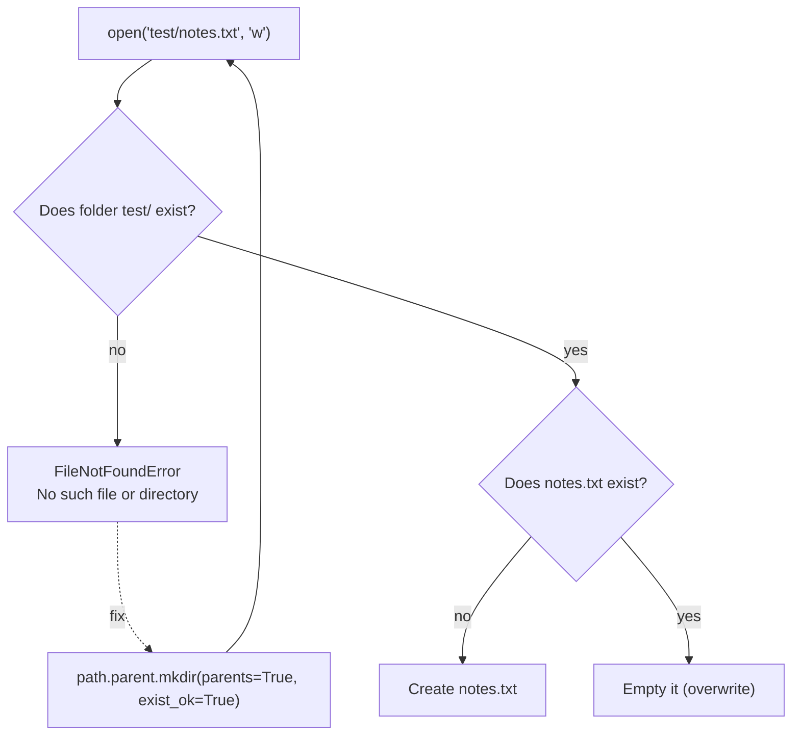

# `open(path, "w")` and missing folders

Demo: `uv run python playground/06-errors-files/open_missing_parent.py`

*Caption: "w" mode can create the file, but never the folders above it.*

A relative path like `./test` starts from the folder you **run** Python
from (the current working directory), not from the folder the `.py` file
lives in.
