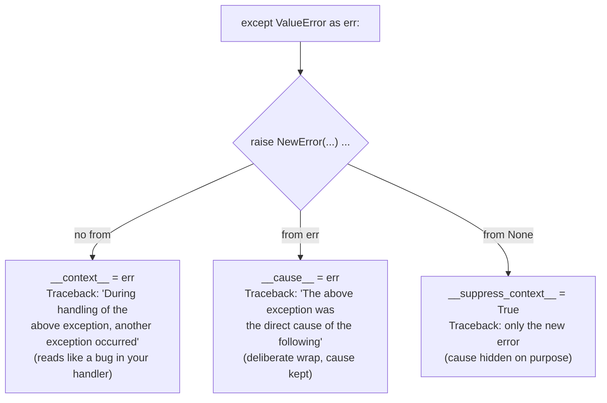

# Three ways to re-raise

Inside an `except` block, you raise a new error. The `from` part decides
what the traceback says about the original one.

*Caption: what each re-raise form stores and what the traceback shows.
Only the `no from` form looks like an accident, so always choose
`from err` or `from None` on purpose.*

Note: `__context__` is set in **all three** cases. Python always records
the original error. `from` only changes what the traceback *prints*:
`from err` and `from None` both set `__suppress_context__ = True`, and the
traceback then shows `__cause__` (or nothing, when it's `None`).

| Form | Use when |
|---|---|
| `from err` | The original error adds detail, e.g. an `OSError` with the path and errno. |
| `from None` | Your message already says it all, e.g. `invalid age: 'abc'`. |
| no `from` | Almost never on purpose. |

Run the demo: `uv run python playground/06-errors-files/repr_and_from_none.py`
