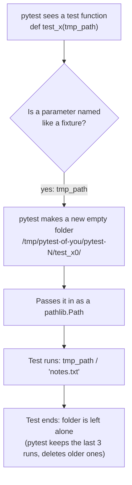

# pytest's `tmp_path` fixture

Demo: `uv run pytest playground/06-errors-files/test_tmp_path_demo.py -s`

*Caption: pytest matches the parameter name `tmp_path` to a built-in fixture,
creates a fresh folder for that one test, and hands it in as a `Path`.*

| Without `tmp_path` | With `tmp_path` |
|---|---|
| Tests write into your real project folder | Tests write into a throwaway folder |
| Leftover files leak into the next test | Every test gets its own empty folder |
| You must clean up by hand | pytest cleans up old runs for you |
