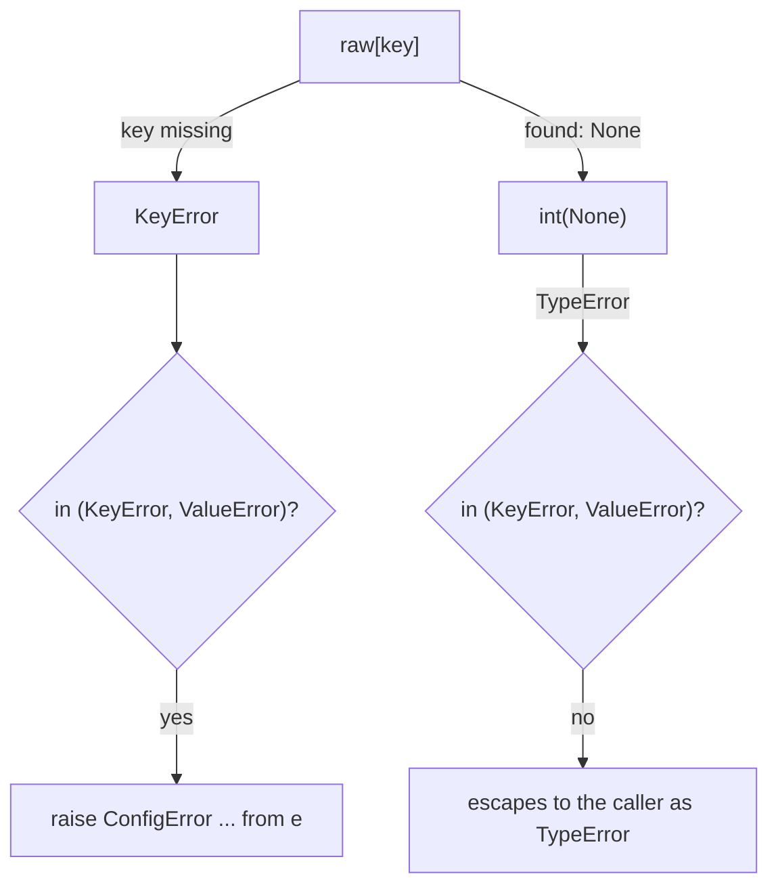
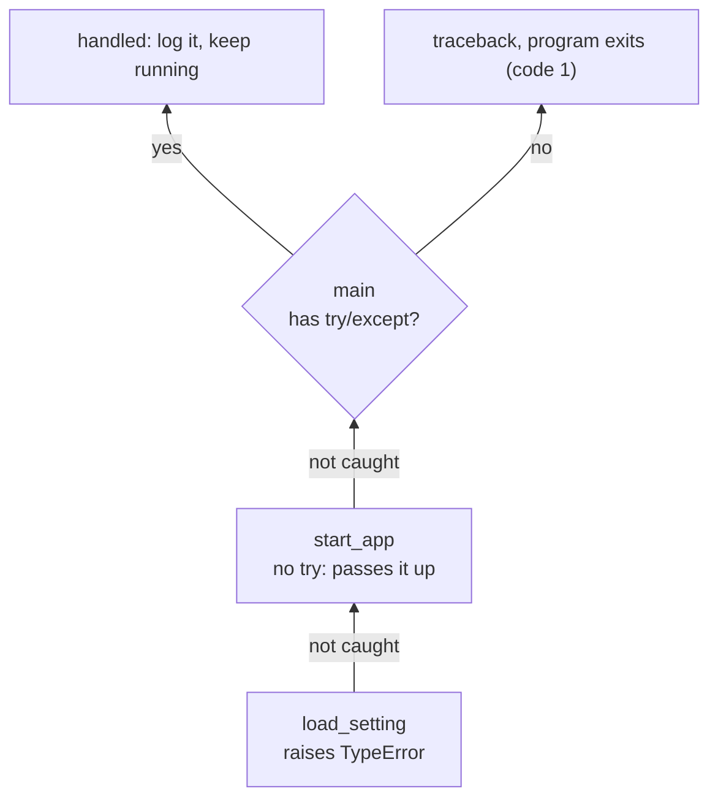

# Does `load_setting({"retries": None}, "retries")` return `None`?

No. It **raises `TypeError`**, and the error escapes `load_setting` unchanged.
Demo: `uncaught_type_error.py`.

*Caption: `except` only catches the types you list. Any other type
skips the handler and keeps going up.*

| Value | `int(value)` | What the caller sees |
|---|---|---|
| `"3"` | `3` | `3` |
| `"many"` | `ValueError` | `ConfigError` (cause: `ValueError`) |
| `None` | `TypeError` | `TypeError`, not wrapped |

Why not `None`? A function returns `None` only when it reaches the end
or hits a bare `return`. A raised exception means it never returns at all.

`ValueError` means "right type, bad content" (`"many"`). `TypeError`
means "wrong type entirely" (`None`).

## Does an uncaught error break the whole program?

Only if **nobody** catches it. Demo: `who_catches_it.py`.

*Caption: the exception climbs the call stack one frame at a time.
The first matching `except` on the way up stops it.*

| Error | Who should catch it | Why |
|---|---|---|
| `ConfigError` (expected) | the caller that has a fallback | e.g. use a default value |
| `TypeError` (a bug) | only a top-level safety net | log it loudly, and don't hide it deep inside |

A crash with a traceback is often the **good** outcome. It points at the
exact line and the bad value. Returning `None` quietly would let the bad
value spread and fail later somewhere confusing.
