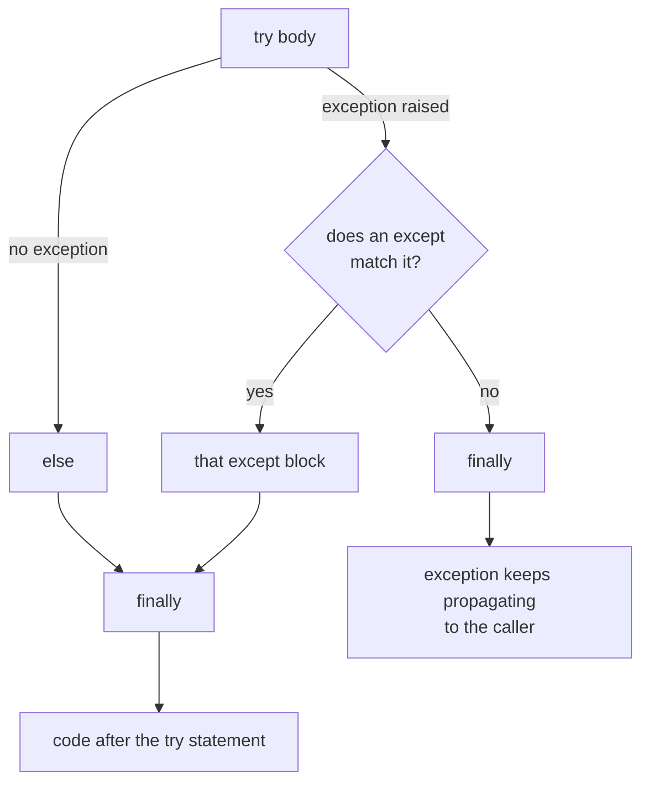

# try / except / else / finally — which blocks run?

Runnable demo: `uv run python playground/06-errors-files/unmatched_exception_flow.py`

*Caption: `else` runs only when the `try` body raised nothing. `finally`
runs on every path. An unmatched exception skips `except` and `else`, runs
`finally`, then escapes. The code after the `try` statement never runs.*

| Case | try | except | else | finally | code after |
|---|---|---|---|---|---|
| No error | ✅ (all of it) | ❌ | ✅ | ✅ | ✅ |
| Error, `except` matches | ✅ (up to the error) | ✅ | ❌ | ✅ | ✅ |
| Error, no match | ✅ (up to the error) | ❌ | ❌ | ✅ | ❌ (the exception escapes) |
