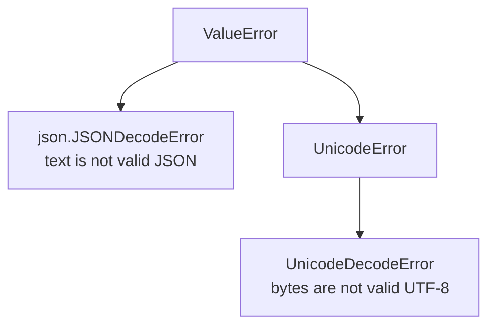

# Which exception does it raise?

Don't guess the type for an `except`. Run the call on bad input and read
the type. Demo: `which_exception.py`.

*Caption: the two are cousins, both under `ValueError`. Catching one
never catches the other.*

| Bad input | Who notices | Exception |
|---|---|---|
| File bytes aren't UTF-8 | `open(..., encoding="utf-8")` while reading | `UnicodeDecodeError` |
| Text is fine, but it isn't JSON | `json.load` | `json.JSONDecodeError` |

`'not json'` is perfectly good UTF-8 text, so the decode step succeeds
and the problem only shows up in the JSON parser.

Three ways to find the type:

1. Read the traceback. Its last line names the type.
2. `type(e).__name__` inside an `except Exception as e:` block while you explore.
3. Read the docs or docstring. They often name it.
